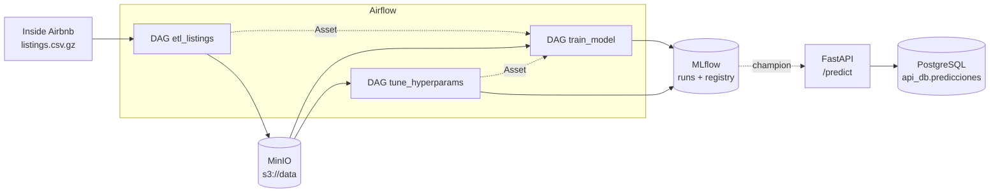
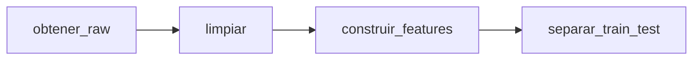
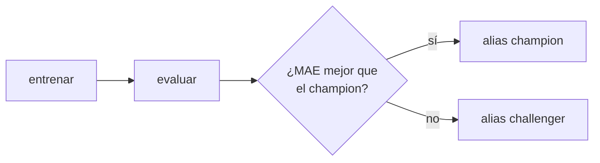

# Precio de Airbnb en Río de Janeiro, en producción
### MLOps1 (AMq2) - CEIA - FIUBA

Llevamos a un entorno productivo el modelo del TP final de Aprendizaje de Máquina I:
un **XGBoost que predice el precio por noche de un aviso de Airbnb en Río de Janeiro**,
con un **MAE de ~250 BRL** en test (el baseline heurístico daba 385).

El entorno simula la infraestructura de *ML Models and something more Inc.*: Airflow
orquesta, MLflow registra experimentos y modelos, MinIO hace de data lake S3,
PostgreSQL guarda metadatos y FastAPI sirve el modelo. Todo corre con Docker Compose,
sobre la base de [amq2-service-ml](https://github.com/facundolucianna/amq2-service-ml).

**Integrantes:** _completar_

## El modelo

- **Datos:** [Inside Airbnb](https://insideairbnb.com/get-the-data/), Río de Janeiro,
  scrape del 24/06/2026. 48.713 avisos y 90 columnas, que tras la limpieza quedan en 44.238.
- **Target:** precio por noche en BRL. El modelo entrena sobre `log(precio)` y devuelve BRL.
- **Features:** 35 (19 numéricas, 13 binarias, 3 categóricas). Lat/lon son las más importantes.
- **Modelo:** XGBoost. Arranca con los hiperparámetros que encontró Optuna en el TP de
  AMq1, y el DAG `tune_hyperparams` puede buscar otros mejores.

| Métrica (test) | Valor |
| --- | --- |
| MAE | 249,6 BRL |
| RMSE | 613,2 BRL |
| MAPE | 31,4 % |
| R² | 0,545 |

El análisis completo y la comparación contra los otros 15 modelos están en el
[notebook del TP de AMq1](https://github.com/lautarovera-edu/fiuba-ceia-amq/tree/tp-full-run/trabajo_final).

**Limitación conocida:** el error tiene forma de U. Es del 46 % en el quintil más
barato, del 23 % en el medio y del 37 % en el más caro.

## Arquitectura



| Servicio | Rol en el TP | URL local |
| --- | --- | --- |
| Airflow | Corre los DAGs de ETL y entrenamiento | http://localhost:8080 (airflow / airflow) |
| MinIO | Data lake: CSV crudo, parquet intermedios, train/test, artefactos de MLflow | http://localhost:9001 (minio / minio123) |
| MLflow | Runs con parámetros y métricas, Model Registry con alias `champion` | http://localhost:5001 |
| PostgreSQL | Metadatos de Airflow y MLflow, log de predicciones (`api_db`) | `localhost:5432` |
| FastAPI | Sirve el modelo `champion` y registra cada predicción | http://localhost:8800/docs |

### DAG `etl_listings` (semanal)



| Task | Qué hace | Escribe |
| --- | --- | --- |
| `obtener_raw` | Baja el snapshot de Inside Airbnb, sólo si todavía no está | `s3://data/raw/listings.csv.gz` |
| `limpiar` | Saca columnas con fuga, parsea el precio y corta precios > 10.000 BRL | `s3://data/interim/listings_limpio.parquet` |
| `construir_features` | Banderas de faltantes, amenities, antigüedad del host | `s3://data/interim/listings_features.parquet` |
| `separar_train_test` | Split 70/30, semilla 42 | `s3://data/final/train.parquet`, `test.parquet` |

Cada task lee y escribe en MinIO, así que ninguna depende de lo que quedó en memoria
de otra y cualquiera se puede reintentar sola.

### DAG `train_model` (se dispara solo cuando cambia `train.parquet`)



1. `entrenar`: ajusta el pipeline con los mejores hiperparámetros disponibles y lo registra
   como nueva versión de `airbnb_rio_price`. Usa los de la búsqueda de `tune_hyperparams`
   con mejor MAE de CV y, si todavía no se corrió ninguna, los de AMq1 (`config.XGB_PARAMS`).
   El run guarda de dónde salieron en el tag `origen_params` (`config` u `optuna:<run_id>`).
2. `evaluar`: calcula MAE, RMSE, MAPE y R² en test (en BRL) y los guarda en el run.
3. `promover`: si la versión nueva tiene mejor MAE que el `champion`, pasa a ser el
   `champion`. Si no, queda como `challenger` y producción no cambia.

`train_model` no tiene horario: está atado a dos Assets. Arranca solo cuando el ETL
escribe `s3://data/final/train.parquet` o cuando `tune_hyperparams` termina una búsqueda.

### DAG `tune_hyperparams` (manual)

Repite la búsqueda de la sección 9.3 del TP de AMq1: Optuna (TPE, semilla 42) con el mismo
espacio de 8 hiperparámetros, evaluando cada trial por CV 3-fold **sólo sobre train**. Test
queda reservado para la comparación champion/challenger.

- Parámetro `n_trials` (20 por defecto). Con los hiperparámetros de AMq1, un trial (3 ajustes
  sobre ~31.000 avisos) tarda unos 4 s en una máquina de 16 núcleos; en el worker de Docker
  depende de los recursos asignados.
- En MLflow, experimento `airbnb_rio_price_optuna`: un run padre `optuna_busqueda` por
  ejecución (métrica `mejor_cv_mae`, artefacto `mejores_params.json`) y un run anidado por trial
  (sus hiperparámetros y `cv_mae`).
- El primer trial es siempre el de los hiperparámetros actuales, así que la búsqueda nunca
  termina peor que la base.
- A diferencia del notebook, el MAE de CV se mide en BRL, no sobre `log(precio)`: es la misma
  métrica con la que después se decide el champion.
- Al terminar actualiza el Asset `airbnb_rio_mejores_params` y dispara `train_model`. El modelo
  nuevo sólo llega a producción si además mejora el MAE en test.

## API

FastAPI sirve la versión `champion` de `airbnb_rio_price`. Cada 60 s se fija si el alias
apunta a otra versión y, si cambió, la carga sola, sin reiniciar el contenedor. Documentación
interactiva en http://localhost:8800/docs.

| Endpoint | Qué devuelve |
| --- | --- |
| `GET /` | `{"estado": "ok"}` (healthcheck) |
| `GET /modelo` | Nombre, alias, versión y MAE en test del modelo en producción |
| `POST /predict` | `{"precio_brl", "version_modelo"}` para un aviso |

`/modelo` y `/predict` responden **503** mientras no haya champion (antes del primer
`train_model`). Un aviso mal formado (campo faltante, `room_type` desconocido, puntaje fuera de
0-5, campo de más) responde **422**.

El aviso se manda con las **columnas crudas de Inside Airbnb**, con los mismos nombres que el CSV.
La API no calcula features por su cuenta: llama a `airbnb_rio.features.construir_features`, el
mismo código que usó el entrenamiento. Los campos que en Inside Airbnb pueden faltar (`bedrooms`,
`beds`, `bathrooms`, puntajes de reseñas, etc.) aceptan `null`.

```bash
curl -X POST http://localhost:8800/predict -H "Content-Type: application/json" -d '{
  "latitude": -22.968, "longitude": -43.184,
  "neighbourhood_cleansed": "Copacabana",
  "room_type": "Entire home/apt", "property_type": "Entire rental unit",
  "accommodates": 2, "bedrooms": 1, "beds": 1, "bathrooms": 1, "bathrooms_text": "1 bath",
  "amenities": ["Wifi", "Air conditioning", "Kitchen", "Free parking on premises"],
  "minimum_nights": 1, "maximum_nights": 365,
  "availability_30": 8, "availability_365": 39, "estimated_occupancy_l365d": 102,
  "number_of_reviews": 17, "reviews_per_month": 2.71,
  "review_scores_rating": 4.94, "review_scores_location": 5.0,
  "review_scores_cleanliness": 5.0, "review_scores_value": 4.88,
  "calculated_host_listings_count": 1,
  "hosts_time_as_host_years": 0, "hosts_time_as_host_months": 6
}'
# {"precio_brl": ..., "version_modelo": "1"}   (el precio real de este aviso es 383 BRL)
```

Cada predicción queda en la tabla `predicciones` de la base `api_db` (fecha, versión del
modelo, aviso recibido y precio). Si PostgreSQL no responde, la API predice igual y deja el
error en su log.

```bash
docker exec postgres psql -U airflow -d api_db \
  -c "SELECT creado, version_modelo, precio_brl FROM predicciones ORDER BY id DESC LIMIT 5"
```

La base `api_db` se crea al inicializar el volumen de PostgreSQL. Si ya tenías el entorno
levantado de antes, creala a mano una vez y reiniciá la API:

```bash
docker exec postgres psql -U airflow -c "CREATE DATABASE api_db"
docker compose restart fastapi
```

Tests de la API (sin MLflow ni PostgreSQL, con adaptadores falsos):

```bash
docker compose exec fastapi sh -c "pip install -q -r requirements-dev.txt && pytest -q"
```

## Estructura del repo

```
├── airflow/dags/
│   ├── etl_listings.py       # DAG de ETL
│   ├── train_model.py        # DAG de entrenamiento + champion/challenger
│   └── tune_hyperparams.py   # DAG de búsqueda de hiperparámetros con Optuna
├── src/airbnb_rio/           # paquete compartido por los DAGs y la API
│   ├── config.py             # columnas, hiperparámetros, rutas S3, nombres de MLflow
│   ├── features.py           # limpieza y features (secciones 2-3 del TP de AMq1)
│   ├── modelo.py             # preprocesador + XGBoost + métricas
│   ├── busqueda.py           # espacio de Optuna y MAE por CV (sección 9.3)
│   └── s3.py                 # lectura/escritura en MinIO
├── dockerfiles/
│   ├── fastapi/
│   │   ├── app.py            # punto de entrada: conecta el núcleo con MLflow y PostgreSQL
│   │   ├── api/              # esquemas, servicio (núcleo), rutas y adaptadores
│   │   └── tests/            # pytest con adaptadores falsos
│   └── ...                   # imágenes del resto de los servicios
└── docker-compose.yaml
```

`src/` se monta en los contenedores de Airflow (`/opt/airflow/src`) y en el de la API
(`/opt/src`), en el `PYTHONPATH` de ambos. La limpieza, las features y el pipeline existen
en un solo lugar.

La API sigue puertos y adaptadores: `api/servicio.py` arma las features, predice y registra
sin saber de dónde sale el modelo ni dónde se guarda la predicción. Eso lo resuelven
`api/fuente_mlflow.py` (Model Registry) y `api/registro_postgres.py`, que se conectan en
`app.py`. Por eso los tests corren sin infraestructura.

## Cómo levantarlo

Requisitos: Docker con **al menos 6 GB de RAM asignados** (Docker Desktop → Settings →
Resources). Con menos, los contenedores de Airflow se caen.

```bash
docker compose --profile all up -d --build
```

(Con Colima o instalaciones viejas el comando es `docker-compose`, con guion.)

Si el puerto 5432 ya está ocupado en tu máquina (otro Postgres), elegí otro:

```bash
PG_PORT=5433 docker compose --profile all up -d --build
```

Esperar a que `docker ps` muestre todo `healthy` (unos minutos la primera vez).

## Cómo correrlo

1. Entrar a Airflow (http://localhost:8080, `airflow` / `airflow`).
2. Activar (*unpause*) `etl_listings` y `train_model`. Arrancan pausados.
3. Disparar `etl_listings` con ▶. Al terminar, `train_model` arranca solo.
4. Ver el resultado en MLflow (http://localhost:5001): experimento `airbnb_rio_price`,
   y en *Models* la versión con alias `champion`.
5. Probar la API en http://localhost:8800/docs (o con el `curl` de la sección [API](#api)).
   Toma el champion nuevo en menos de un minuto.
6. Opcional: activar `tune_hyperparams` y dispararlo con ▶ → *Trigger with config* para elegir
   `n_trials`. Al terminar, `train_model` arranca solo con los mejores hiperparámetros.

Si Inside Airbnb no está accesible, se puede subir el CSV a mano antes del paso 3
(`obtener_raw` lo detecta y no descarga):

```bash
docker run --rm --network ceia-mlops1-tp_backend -v "$PWD":/w --entrypoint sh \
  coollabsio/minio:RELEASE.2025-04-22T22-12-26Z -c \
  "mc alias set s3 http://s3:9000 minio minio123 && mc cp /w/listings.csv.gz s3/data/raw/"
```

Apagar: `docker compose --profile all down`. Borrar todo, datos incluidos:
`docker compose down --rmi all --volumes`.

## Decisiones de diseño

1. **El preprocesamiento vive en un solo lugar.** Imputación, escalado, one-hot y la
   agrupación de categorías raras se serializan junto con XGBoost. Las features que
   dependen sólo de la fila (banderas, amenities, antigüedad del host) las arma
   `construir_features`, que usan tanto el ETL como la API. La API recibe el aviso crudo,
   lo pasa por esa función y predice. Si el preprocesamiento viviera en dos lugares, tarde
   o temprano se desincronizarían y el modelo predeciría basura sin tirar error.
2. **El logaritmo del target no sale del modelo.** `TransformedTargetRegressor` entrena
   sobre `log(precio)` y aplica `exp()` al predecir, así el artefacto devuelve BRL.
   Olvidarse el `exp()` en la API es el bug más probable de este TP.
3. **Categorías raras con `min_frequency`.** En el notebook, los barrios con menos de
   200 avisos se pasaban a mano a "Otros". Ahora lo hace el `OneHotEncoder`
   (`min_frequency=200`, `handle_unknown="infrequent_if_exist"`): queda ajustado sobre
   train y un barrio nunca visto cae en "Otros" en vez de romper. Por esa diferencia el
   MAE pasó de 250,5 a 249,6.
4. **Snapshot fijo de datos.** Inside Airbnb re-scrapea seguido: entre marzo y junio los
   faltantes de `bedrooms` pasaron de 123 a 6.446. La URL apunta a una fecha fija para
   que los números sean reproducibles.
5. **Sólo XGBoost.** Los otros 15 modelos del TP quedan en el notebook como evidencia.
   SVR solo tardaba 107 minutos. Los hiperparámetros de Optuna de AMq1 están en
   `src/airbnb_rio/config.py` y son el punto de partida de la búsqueda.
6. **Nueva búsqueda ≠ nuevo modelo en producción.** `tune_hyperparams` elige con CV sobre
   train; el reentrenamiento que dispara pasa igual por champion/challenger en test. Así una
   búsqueda con pocos trials o con suerte en la CV no puede empeorar lo que sirve la API.

## Estado

**Primera entrega**
- [x] Servicios de base en Docker Compose
- [x] Paquete `src/airbnb_rio` con la limpieza, las features y el pipeline del TP de AMq1
- [x] DAG `etl_listings`: CSV crudo → parquet de train/test en MinIO
- [x] DAG `train_model`: entrenamiento, registro en MLflow y champion/challenger

**Entrega final**
- [x] Experimento de búsqueda de hiperparámetros en MLflow (Optuna, un run anidado por trial)
- [x] API: `POST /predict` que devuelve BRL, cargando el `champion` del registry
- [x] Log de predicciones en PostgreSQL
- [x] Documentación de la API (`/docs`) acorde al modelo

## Más sobre el entorno

Detalles de la infraestructura base (variables de Airflow, conexiones, CLI, acceso a
los buckets desde afuera de Docker) en el
[README original de la cátedra](https://github.com/facundolucianna/amq2-service-ml#readme).
